# Visual review — "Dawn Luxury"

Real screenshots, captured with headless Chromium against the local dev server
(`127.0.0.1:3000`). "Before" images come from a second worktree checked out at
`3bb4cae` (the merged `main`, i.e. the pre-redesign code) served on port 3101.
Both runs used the same browser, viewport, locale/theme cookies and a 1.4–1.8 s
settle delay, so the pairs are directly comparable.

## Home — dark, English, 1440 × 900 (full page)

| Before | After |
| --- | --- |
| 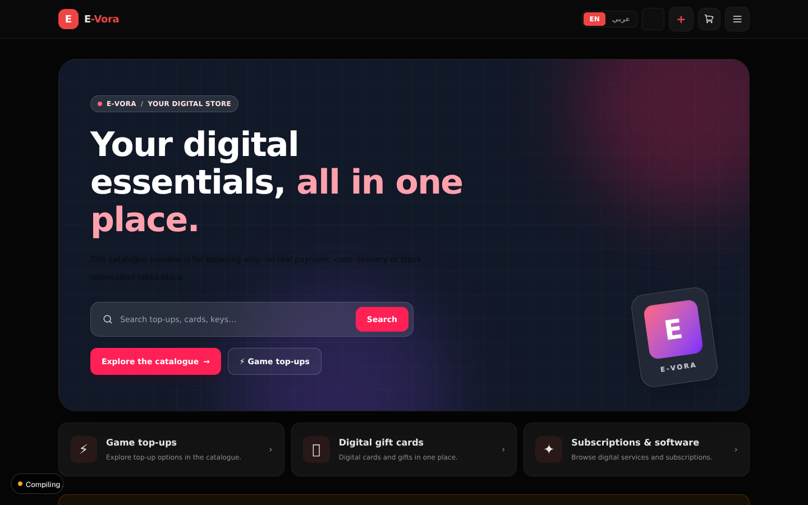 | 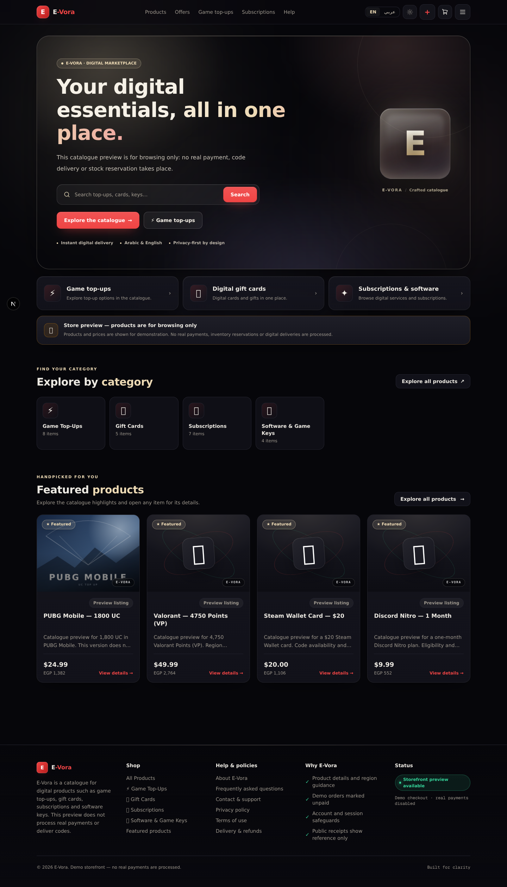 |

The old hero was a blue-black panel with a pink/violet gradient logo and a grid
overlay; the copy had a red-tinted paragraph at low contrast and no depth. The
redesign replaces it with an obsidian panel, champagne ambient light drifting in
from the top-right, a glass "E" mark, a champagne eyebrow pill, a breathing
search field with a focus glow and a staggered entrance.

## Home — light, 1440 × 900

| Before | After (Arabic RTL) |
| --- | --- |
| 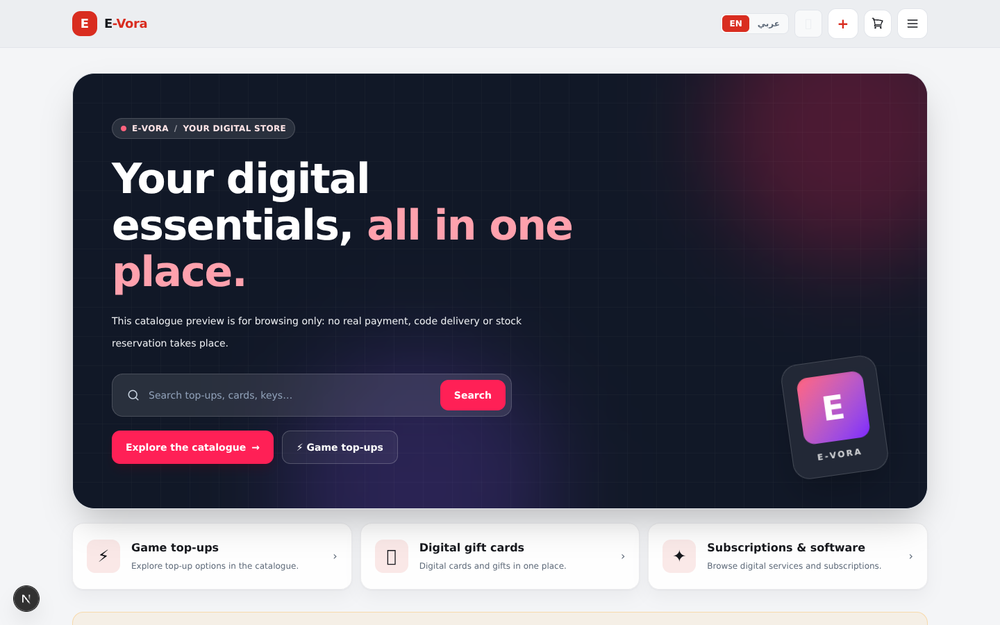 | 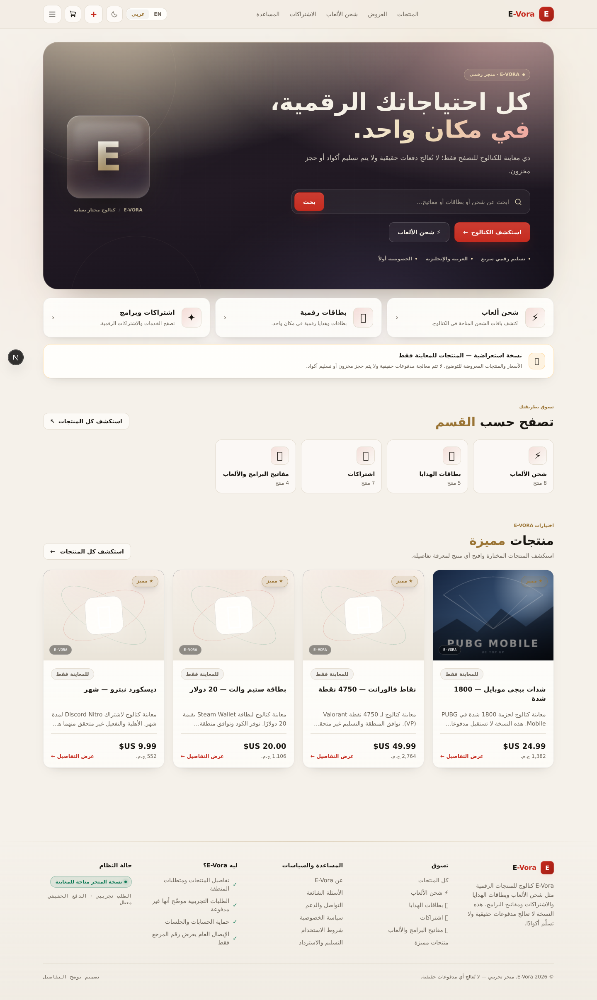 |

Light mode is no longer a flat grey inversion: warm ivory paper, champagne
accents that darken to stay legible (`#9a7434`), and a deliberately dark hero
panel that carries the same identity in both themes. The Arabic capture doubles
as the RTL check — logo, nav, hero mark, ornaments and drawer all mirror, and the
Cairo headings keep their joined letterforms.

## Products listing — dark, 1440

| Before | After |
| --- | --- |
| 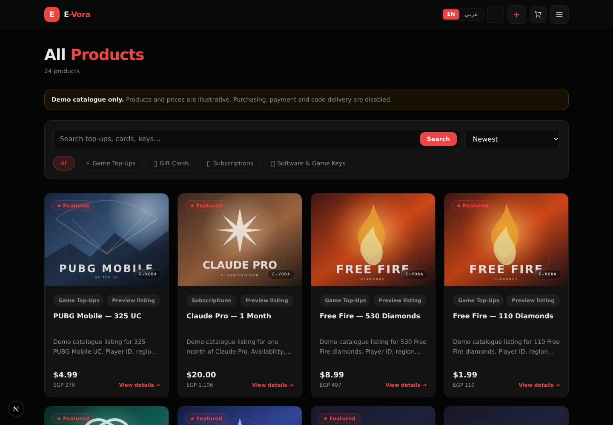 | 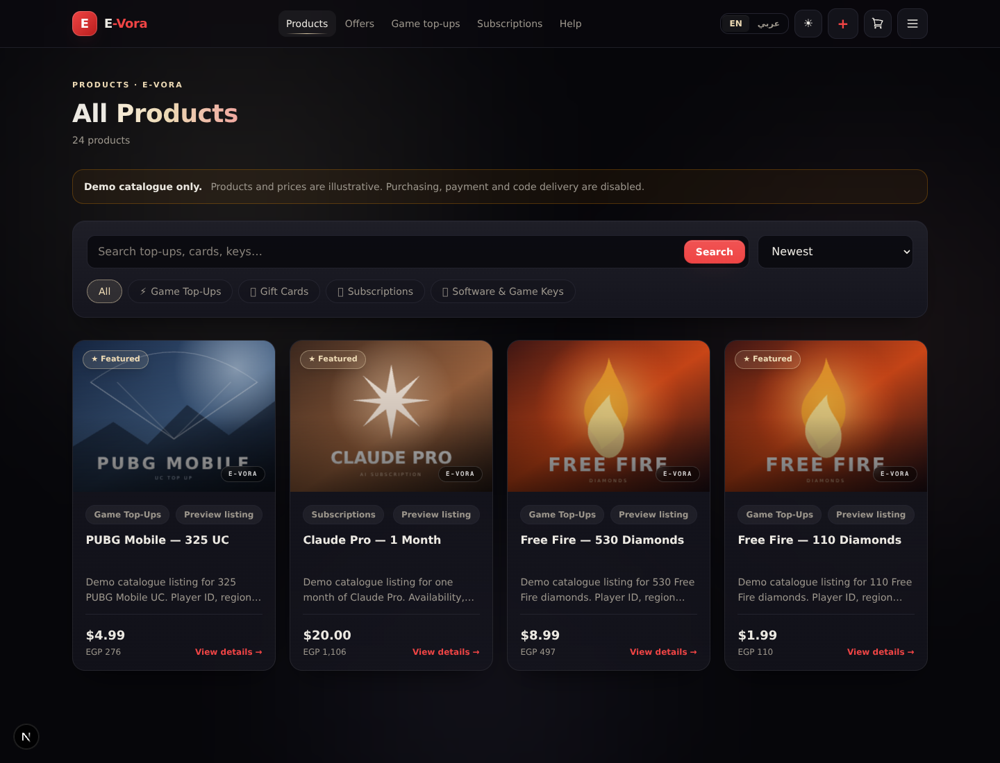 |

Product tiles gain an artwork zoom layer, hover sheen, champagne "E-VORA" chip,
soft border glow on hover and a lift; the filter bar becomes a glass surface with
champagne pills, and the page gets an eyebrow + gradient title.

## Interiors and mobile

| Products — light | Product detail — dark |
| --- | --- |
| 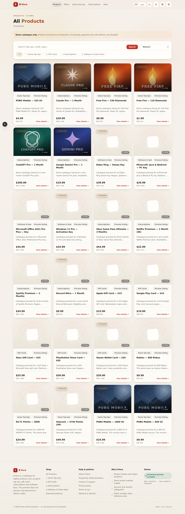 | 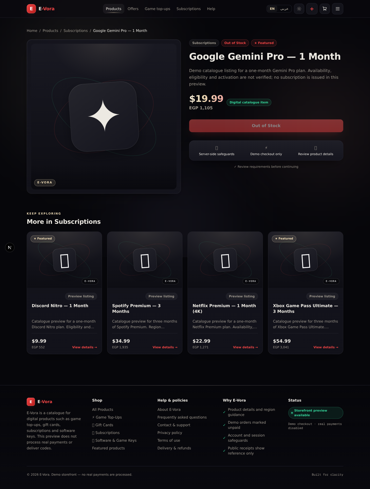 |

| Products — 390 px, Arabic | Drawer — 390 px, Arabic |
| --- | --- |
| 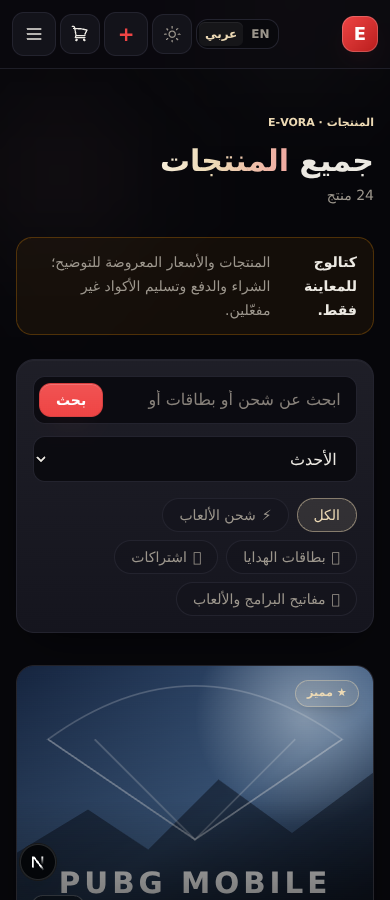 | 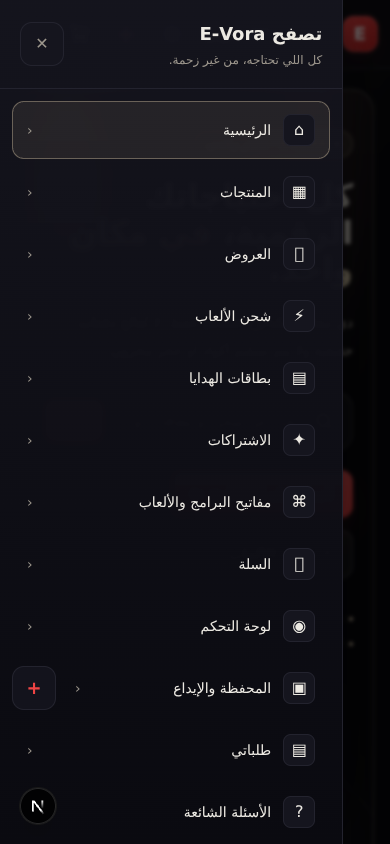 |

## Home — 390 px, dark

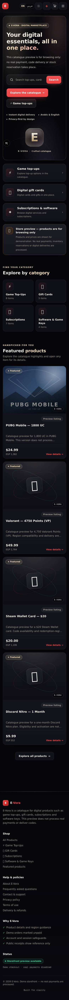

Hero content comes first on a phone (the glass mark follows it), the CTAs stack
full-width, and the fixed ambient layer drops its third light source and halves
its blur below 640 px.

## What was measured, not just seen

- `document.scrollWidth - window.innerWidth = 0` on every capture above
  (320/390/1440, Arabic and English).
- Zero `.reveal` / `.rise-in` elements left at `opacity: 0` after a scripted
  scroll through each page.
- Drawer at 390 px: full viewport height, 16 links, focus moved inside.
- Zero `pageerror` events across all captured pages.
